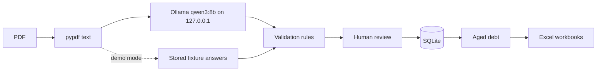

# AR Copilot

A student prototype for the data-entry side of accounts receivable. It reads invoice PDFs with a
local language model, checks the extracted fields against accounting rules, makes a person
approve every document, and turns the approved documents into an aged-debt report and Excel
workbooks.

All data in the repository is fictional. The supplier is "Northbridge Auto Components Ltd" and
the five customers are made up.


## The problem

An accounts receivable team keys invoices and credit notes into a ledger, matches payments to
them, and chases whatever is overdue. Typing twelve fields from each PDF is slow, and a wrong
total or date carries straight through to the aged-debt report that decides who gets chased.

A language model can pull the fields out of a PDF quickly, but it can also be confidently wrong.
So in this app the model only fills in a draft. Deterministic rules check that draft, and a
reviewer compares it with the PDF before anything reaches the register.

## What it does

The app is a Streamlit site with three pages.

- **Review queue.** Shows the PDF next to its twelve extracted fields: document type, supplier,
  customer, document number, invoice and due dates, PO number, currency, net, VAT, total and
  linked invoice. Failed checks are listed in plain language. The reviewer can correct fields,
  then approve, save or reject with their name and a reason. Every decision goes into a history
  table, and approved documents are locked.
- **Aged debt.** For a chosen reporting date, works out each approved invoice's balance after
  payments and credit notes, and puts it in a bucket: current, 1–30, 31–60, 61–90 or 91+ days
  overdue. It shows totals, a chart by customer, the invoice list, and anything left out
  (unapproved documents and payments with no matching invoice). Two workbooks can be downloaded
  from here.
- **Time a document.** Times a person entering a document by hand against checking the model's
  draft of a comparable one. A one-person pilot has been run (see [Timing pilot](#timing-pilot)).

The sidebar loads the 40 demo documents, uploads PDFs for extraction, and imports a payment
ledger CSV.


## How extraction, validation and review fit together



1. **Text.** `pypdf` pulls the text layer out of the PDF. Scanned PDFs have no text layer and
   are rejected, because there is no OCR.
2. **Extraction.** The text goes to Ollama's `/api/chat` endpoint with a JSON schema that requires
   all twelve fields as strings or null. The model is `qwen3:8b`. Temperature is 0, the seed is
   fixed and thinking is off. The document is sent as data in the user message and the
   instructions go in the system message. The output is parsed with strict Pydantic validation:
   extra keys, missing keys and numbers in place of strings are all rejected.
3. **Rules.** [`ar_copilot/core.py`](ar_copilot/core.py) checks the fields. Required fields must
   be present: a PO for invoices, a linked invoice for credit notes. The supplier, customer and
   currency must be known values. Dates must parse, and the due date can't come before the
   invoice date. Amounts must have at most two decimals, net plus VAT must equal the total, VAT
   must be 20%, and credit notes must be negative.
4. **Review.** Every document lands in the queue, whether extraction worked or not. If it failed,
   the reason is shown and the reviewer types the fields in from the PDF. A document can only be
   approved once all rules pass.

Extraction never approves anything. The model's output and the reviewer's corrections are stored
separately, so you can always see what the model actually returned.

**Demo mode** is not model extraction. The 40 generated PDFs come with stored answers, and
**Load 40 offline demo documents** (or the "Replay offline demo fixtures" checkbox) replays those
answers so the rest of the app can be tried without Ollama. The review page shows which source
each document came from ("offline fixtures" or "Ollama (qwen3:8b)").

## Accounting and Excel

- Money is handled as `Decimal` all the way to the spreadsheet, so there is no floating-point drift.
- Duplicates are blocked twice: the same PDF file can't be added twice (SHA-256), and two
  approved documents can't share supplier, customer, type and document number.
- A credit note can only be approved against an approved invoice for the same customer, and it
  can't be dated before that invoice.
- Ageing counts only approved documents dated on or before the reporting date. Payments count
  when they match the invoice number and customer and are dated on or before that date. An
  invoice due on the reporting date is current. Overpayments are kept as negative balances
  rather than hidden.
- The **aged-debt workbook** contains real Excel tables (`PostedReceivables`, `AgedDebt`,
  `Payments`), a `ReportingDate` named cell, and a Summary sheet whose totals are `SUMIF`
  formulas over `AgedDebt`. Text cells are written so they can't be interpreted as formulas.
- The **posted receivables register** is the same document register on its own.
- [`excel/aged_debt.pq`](excel/aged_debt.pq) is a Power Query that rebuilds the aged-debt table
  inside Excel from the exported tables, so the buckets can be checked, or recalculated for a
  new date, without Python. I checked it in Excel against a hand-built fixture on 10 October
  2026. It matched the Python output with no differences. See [excel/README.md](excel/README.md).

## Microsoft 365

Outside the app, a manually triggered Power Automate flow reads the `AgedDebt` table from an
exported workbook in OneDrive and emails the overdue rows to the flow owner. I ran it manually on
10 October 2026, and it completed and sent the test email to me. It only runs when triggered by
hand. There's no schedule, no check that the workbook is current, and no protection against
sending the same email twice, and it reads at most 256 rows because pagination is off.
[docs/microsoft365.md](docs/microsoft365.md) describes exactly what was built and what wasn't.

## Evaluation

The extraction was scored against the 40 generated documents. There were 39 invoices and one
credit note across three layouts, and two of the documents had deliberate problems: a missing PO
number and a total that doesn't add up. Each of the twelve fields was compared with the printed
value as an exact string match. The run used qwen3:8b on the local machine, one attempt per
document, with no retries.

| Result | Value |
| --- | ---: |
| Documents completed | 40/40 |
| Fields correct | 480/480 |
| Documents with every field correct | 40/40 |
| Deliberate anomalies caught by the rules | 2/2 |
| Rule false positives | 0 |
| Runtime failures | 0 |
| Credit note (including linked invoice) correct | 1/1 |
| Median time per document | 2.12 s |
| Total model request time | 104.99 s |

Source: [results/ollama_summary.md](results/ollama_summary.md), generated by
[`scripts/publish_results.py`](scripts/publish_results.py) from the raw run report (run
`20261010T222850367164Z`). The raw report holds invoice text and model output, so it stays local
and is not committed.

How to read this:

- It is a **small synthetic dataset**: 40 documents from one generator, three clean digital
  layouts, one supplier and five customers. The prompt was written with these layouts in view.
  A perfect score here says the pipeline works on tidy, predictable PDFs. It says nothing about
  accuracy on real invoices.
- **Processing time is not time saved.** 104.99 seconds is how long the model took to respond.
  It doesn't include anyone reading or checking the results. Human time is measured separately in
  the timing pilot below.
- Demo mode would also score 100%, because its answers come from the ground truth. That only
  shows the scoring code is wired up, and it is never reported as model accuracy.

Commands for re-running or resuming the evaluation are in [docs/evaluation.md](docs/evaluation.md).

## Timing pilot

In a single-participant pilot using 12 synthetic invoices matched by layout, median time per
document fell from 85.0 seconds manually to 7.0 seconds with Ollama-assisted review, a 91.8%
reduction. Manual entry produced six field errors; assisted entry produced none. Assisted timings
included extraction, review, correction and submission.

| | Manual | Ollama-assisted |
| --- | ---: | ---: |
| Completed / attempted | 6/6 | 6/6 |
| Median time per document | 85.0 s | 7.0 s |
| Interquartile range | 76.4–90.6 s | 5.3–8.3 s |
| Range | 61.2–91.0 s | 3.7–13.4 s |
| Field errors after submission | 6 of 72 (8.3%) | 0 of 72 |
| Fields changed by the reviewer | – | 0 |
| Decision errors, failed or incomplete attempts | 0 | 0 |
| Median extraction wait | – | 2.2 s |

Source: [results/timing_summary.md](results/timing_summary.md), generated by
[`scripts/summarize_timings.py`](scripts/summarize_timings.py). The raw attempt log stays local.
The reduction is `100 × (manual median − assisted median) / manual median`. Taking each pair
separately, the median saving was 74.5 s per pair, which is lower than the 78.1 s gap between the
two medians.

What was checked before publishing:

- Every assisted attempt made a fresh qwen3:8b call. Ollama's own server log shows six chat
  requests at the recorded times, with matching durations.
- Each recorded duration matches its start and finish timestamps to within a millisecond.
- The one practice attempt is excluded. No demo fixtures were used.

How to read it:

- **One participant, six documents per method.** The participant is the developer, who already
  knew the layouts and the app. The documents were clean synthetic invoices, so this is a pilot,
  not a causal or production-performance result.
- **The assisted reviews were very quick.** After extraction, each assisted document was on
  screen for 1.6–9.0 s (median 4.7 s) before submission. The participant reports checking every
  field. The log can show how long each document was on screen, but not whether it was reviewed.
- **Zero assisted errors is mostly the model's result.** The model made no mistakes on these six
  documents, and no fields were changed. So the pilot doesn't show whether a reviewer working
  this fast would catch a model error. All twelve documents were valid invoices, so the decision
  check couldn't catch a missed anomaly either.
- **Manual errors are exact-match differences.** Typed values aren't stored, so it's unknown how
  many of the six were wrong values and how many were formatting differences, such as a date
  typed in another format.
- **Practice was uneven.** Only one manual practice attempt was recorded, and no assisted
  practice. The first assisted task was the slowest one (13.4 s, including a 4.4 s extraction
  while the model warmed up).

## Install and run (Windows)

You need Python 3.12 and [Ollama](https://ollama.com) with the model pulled:

```powershell
ollama pull qwen3:8b
py -3.12 -m venv .venv
.\.venv\Scripts\python.exe -m pip install -r requirements.lock.txt
```

The 40 demo PDFs and the payment ledger are generated into `data/`, which is not committed:

```powershell
.\.venv\Scripts\python.exe -m ar_copilot.generate
```

Start the app with Ollama running:

```powershell
.\.venv\Scripts\python.exe -m streamlit run app.py --server.address 127.0.0.1 --browser.gatherUsageStats false
```

Then open http://127.0.0.1:8501. A quick tour:

1. Click **Load 40 offline demo documents**, then import `data/payments.csv` under Payments.
2. In the review queue, approve the documents that pass. NC-0006 and NC-0009 should fail their
   checks.
3. Open **Aged debt** and download a workbook.
4. To try real extraction, upload a text-based PDF with the fixture checkbox off. A PDF that is
   already in the queue is skipped as a duplicate.

Decisions are kept in `runtime/ar.sqlite`. Delete that file to start again, and keep it if you
want to keep your review history. No API key is needed. `.env` is optional, and
[.env.example](.env.example) shows the only two settings. The app only accepts
`http://127.0.0.1:11434` and `qwen3:8b`, and won't start an extraction with anything else.

Tests (offline, using mocked Ollama responses and temporary copies of the data):

```powershell
.\.venv\Scripts\python.exe -m pytest -q
```

More detail: [Ollama settings and limits](docs/ollama.md), [testing](docs/testing.md),
[timing study procedure](docs/timing_procedure.md).

## Design decisions

- **Local model only.** Invoice text is sent to Ollama on the loopback address and nowhere else.
  The HTTP client ignores proxy settings and refuses redirects. The app asks Ollama for the
  model's details first and refuses cloud-backed models. If Ollama isn't available, the document
  goes to review with an error, and there is no fallback to a cloud API. An earlier version
  called a hosted model. It was removed so that document text never leaves the machine.
- **Reject rather than truncate.** The context window is set to 4,096 tokens. Before sending,
  the app estimates the size of the request from its UTF-8 byte count, which is deliberately
  pessimistic. A document that might not fit is sent to manual review instead of being cut short.
  Responses that hit the output limit are rejected as well.
- **Rules are separate from the model.** The checks are ordinary Python, so they behave the same
  whether a field came from the model, from a fixture or from a person.
- **Approval is local.** "Approve" means approved in this app's register. Nothing is posted to a
  real accounting system.

## Limitations

- No OCR, so scanned invoices can't be extracted.
- The rules are built for the fictional dataset: one supplier, a fixed customer list, GBP only
  and 20% VAT.
- Accuracy on real invoices is unknown.
- Time saved has only been measured in a one-person pilot on six synthetic documents per method
  (see [Timing pilot](#timing-pilot)). It says nothing about real invoices or other reviewers.
- Single user. There are no logins, and the reviewer name is free text.
- The size check can turn away documents that would actually have fitted.
- The Microsoft 365 flow is manual and has none of the safeguards a scheduled job would need.

## Repository layout

| Path | Contents |
| --- | --- |
| `app.py`, `views/` | Streamlit app and its three pages |
| `ar_copilot/` | Extraction, Ollama client, rules, storage, export, evaluation, timing, data generator |
| `excel/` | Power Query files, the hand-checked fixture, and an unused Office Script (see the Microsoft 365 doc) |
| `scripts/` | Summary publishing, local end-to-end check, fixture builder, timing helpers, file audit |
| `results/` | Metrics-only evaluation and timing summaries |
| `tests/` | pytest suite (and Node tests for the Office Script and journal helper) |

Local-only and ignored by Git: `.env`, `data/`, `runtime/` (review database, timing data),
`reports/` (raw evaluation reports), `output/` and `tmp/`.

Developed with implementation and review assistance from Codex and Claude Code.
