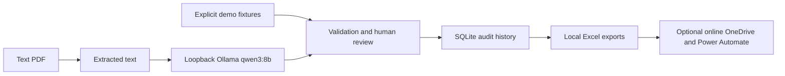

# AR Copilot

AR Copilot reads invoice PDFs, requires human review, keeps a SQLite audit history and exports receivables to Excel. Its architecture is **local LLM extraction with optional online Microsoft 365 automation**.

The sole real LLM is the installed Ollama **qwen3:8b**, accessed only at **http://127.0.0.1:11434**. Invoice text never goes to a cloud LLM. Offline demo mode explicitly replays generated fixtures; it does not perform LLM inference. The application has no global offline switch, so intended online integrations remain available separately.

## What it does

- Extracts twelve invoice/credit-note fields from PDF text using a required-field JSON schema and independent strict validation.
- Treats document text as untrusted data; rejects oversized inputs without truncating and routes malformed output, timeouts and unavailable models to review.
- Reuses Decimal accounting checks, duplicate prevention, review/approval, SQLite audit history, payments, linked credit notes and ageing.
- Exports local Excel registers and aged-debt workbooks for the separate Microsoft 365 workflow.
- Records manual versus Ollama-assisted timings only when a person actually performs the timed tasks.



## Setup and launch on Windows

Ollama and qwen3:8b must already be installed and available. Dependencies can be installed using:

```powershell
py -3.12 -m venv .venv
.\.venv\Scripts\python.exe -m pip install -r requirements.lock.txt
```

The app needs no LLM API key. Optional `.env` settings are in [.env.example](.env.example); the endpoint and model are enforced. Start from this repository:

```powershell
.\.venv\Scripts\python.exe -m streamlit run app.py --server.address 127.0.0.1 --browser.gatherUsageStats false
```

Open http://127.0.0.1:8501. Upload PDFs for Ollama extraction, inspect every field and resolve any validation failures before approval. Approval is a local register action, not an accounting-system posting. Keep existing `runtime/ar.sqlite` to retain decisions and history.

For the fictional fixture demo, generate documents only if the dataset is missing:

```powershell
.\.venv\Scripts\python.exe -m ar_copilot.generate
```

Use **Load 40 offline demo documents** or explicitly enable demo fixture replay for uploads. Fixture replay only accepts exact generated PDFs. Internet may be disconnected manually after dependencies and the model are installed: the local app can still extract, review and export. Online Microsoft 365 automation requires internet access. Network isolation has not been verified.

## Saved synthetic-dataset evaluation

The committed [safe Ollama summary](results/ollama_summary.md), regenerated from the saved raw report, supports:

| Metric | Result |
| --- | ---: |
| Completed documents | 40/40 |
| Correct fields | 480/480 |
| Correct documents | 40/40 |
| Intentional anomalies detected | 2/2 |
| Rule false positives | 0 |
| Runtime failures | 0 |
| Extraction processing | 104.99 seconds |

These are **synthetic-dataset results**, not real-invoice accuracy or human time savings. The missing PO, inconsistent totals and linked credit note are included. Failures count as wrong in overall accuracy; completed-document accuracy is reported separately. Raw responses and extracted values remain under ignored `reports/ollama/`. Historical raw reports are retained locally, and existing Git history is preserved.

For a new corpus/run, first run the three-layout check; then run the sequential checkpoint evaluator:

```powershell
.\.venv\Scripts\python.exe -m ar_copilot.evaluate --mode ollama --sample per-layout
.\.venv\Scripts\python.exe -m ar_copilot.evaluate --mode ollama --sample full --resilient --pace 0 --max-attempts 1
```

Resume the existing completed report without repeating successful inference calls:

```powershell
.\.venv\Scripts\python.exe -m ar_copilot.evaluate --mode ollama --sample full --resilient --pace 0 --max-attempts 1 --resume .\reports\ollama\resilient_20261010T222850202032Z.json
```

For an interrupted run, substitute its printed checkpoint path. Regenerate the safe summary locally:

```powershell
.\.venv\Scripts\python.exe scripts\publish_results.py .\reports\ollama\resilient_20261010T222850202032Z.json
.\.venv\Scripts\python.exe -m pytest -q
```

## Documentation

- [Ollama settings, context limits and offline operation](docs/ollama_setup.md)
- [Evaluation checkpoints and resume](docs/retry_resume.md)
- [Local QA](docs/local_testing.md) and [timing procedure](docs/timing_procedure.md)
- [Excel workflow and fixture](excel/README.md)
- [Separate OneDrive/Power Automate/email workflow](docs/microsoft365_onedrive.md)
- [Proposed SharePoint/Teams extension](docs/microsoft365.md)
- [Release review](docs/release_review.md) and [public repository contents](docs/public_repository.md)

Scanned PDFs need OCR, which is not implemented. Conservative context checks may reject text that would fit with exact tokenization. Human review is mandatory. Microsoft 365 configuration, delivery safeguards and any real human timing study remain separate manual work.
