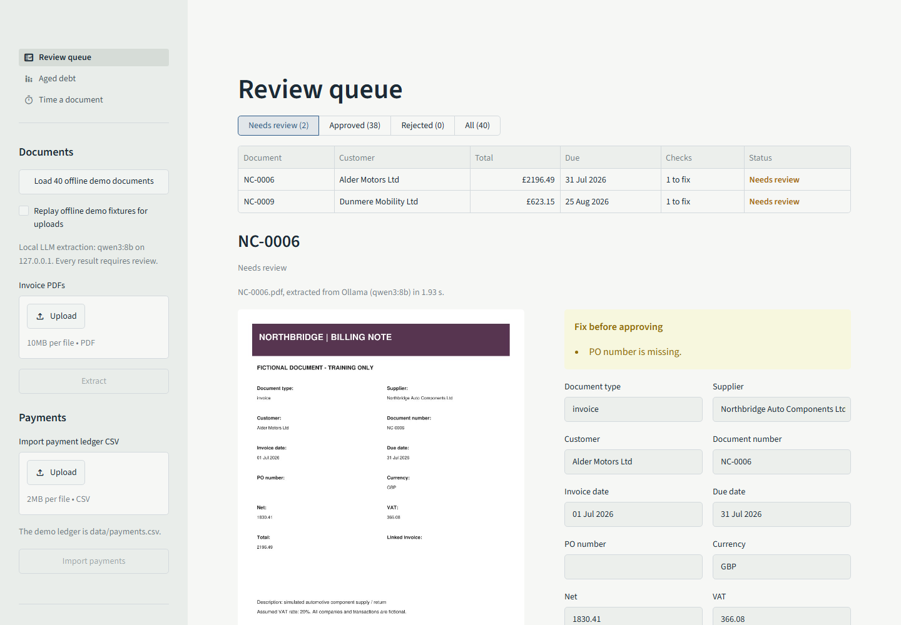
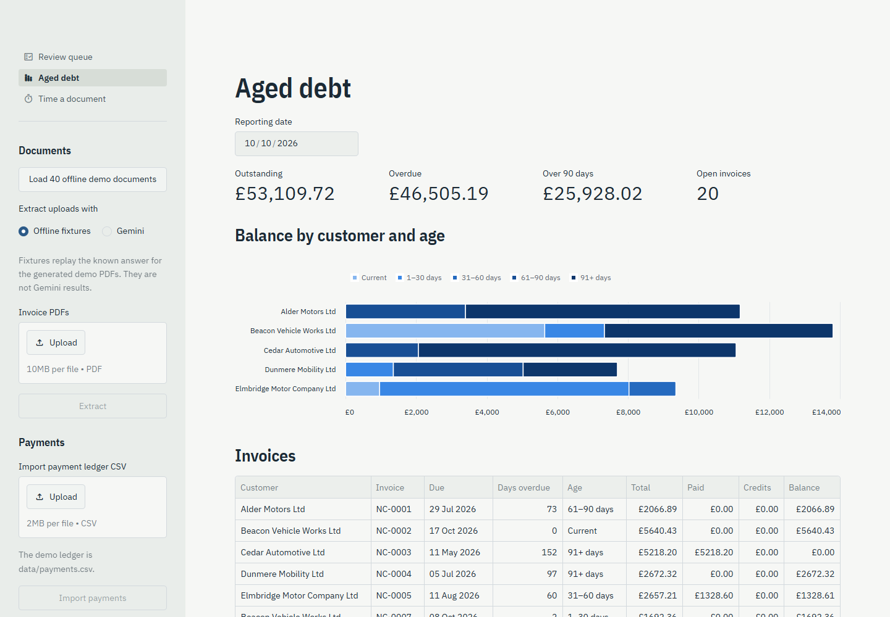
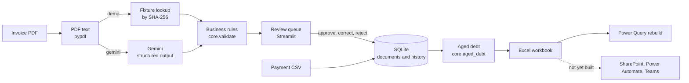

# AR Copilot

An accounts-receivable assistant for Northbridge Auto Components Ltd, a fictional automotive
supplier. It reads invoice PDFs, extracts their fields with Gemini, checks them against
business rules, and puts every document in front of a person to approve, correct or reject.
Approved invoices and imported payments become an aged-debt report and an Excel workbook.

All companies, documents and payments are invented. Nothing here posts to an accounting
system or sends a message.



## What it does

- **Extracts** twelve fields from text PDFs: Gemini with a JSON schema, or offline fixtures for the demo.
- **Checks** each document: required fields, known customer, GBP, date order, net + VAT = total, VAT at 20%,
  and negative amounts plus a linked invoice for credit notes.
- **Queues everything for review.** A passing document still needs a named reviewer. Approval locks it,
  every decision is logged, and the same invoice can't be posted twice, even from a different PDF.
- **Ages the debt** at any reporting date, applying payments and linked credits, and exports a styled
  workbook with a formula-driven summary sheet, a chart and a [Power Query rebuild](excel/README.md).
- **Measures itself.** An evaluator scores extraction against printed ground truth. A timing page records
  how long a document takes to key by hand and through the assisted flow.



## How it fits together



| Path | Role |
| --- | --- |
| `app.py`, `views/` | Streamlit app: review queue, aged debt, timing |
| `ar_copilot/core.py` | Validation rules and aged-debt calculation |
| `ar_copilot/extract.py` | PDF text, Gemini call, offline fixtures |
| `ar_copilot/store.py` | SQLite storage, review decisions, payment import |
| `ar_copilot/export.py` | Excel workbooks |
| `ar_copilot/evaluate.py`, `resilient.py`, `retry.py` | Extraction evaluation, with paced retries and resume |
| `ar_copilot/generate.py` | Seeded fictional corpus: 40 PDFs, truth, payments |
| `excel/` | Power Query script and its hand-computed fixture |
| `results/` | Committed, metrics-only evaluation results |

## Quickstart

Python 3.12. PowerShell:

```powershell
python -m venv .venv
.\.venv\Scripts\Activate.ps1
python -m pip install -r requirements.txt
python -m ar_copilot.generate
python -m streamlit run app.py
```

bash or zsh:

```bash
python3 -m venv .venv
source .venv/bin/activate          # Git Bash on Windows: source .venv/Scripts/activate
python -m pip install -r requirements.txt
python -m ar_copilot.generate
python -m streamlit run app.py
```

In the app, choose **Load 40 offline demo documents**, then import `data/payments.csv` under
**Payments**. Run the tests with `python -m pytest -q`.

To use Gemini, copy `.env.example` to `.env` and set `GEMINI_API_KEY`. The model defaults to
`gemini-3.8-flash`; `python -m ar_copilot.evaluate --check-config` confirms a key is set without
printing it. See [Gemini setup](docs/gemini_live_testing.md).

## Results

Extraction was measured on 10 October 2026 with `gemini-3.8-flash`, scoring exact string matches against the printed values. Full tables:
[full run](results/gemini_summary.md), [smoke test](results/gemini_smoke_summary.md).

| | Full run (40 documents) | Smoke test (1 per layout) |
| --- | --- | --- |
| API returned a result | 4/40 (10%): 34 × HTTP 429, 2 × HTTP 503 | 3/3 |
| Field accuracy on completed documents | 48/48 (100%) | 36/36 (100%) |
| Field accuracy overall, failures counted as wrong | 48/480 (10%) | 36/36 (100%) |
| Intentional anomalies caught by rules | 0/2: both calls failed, so neither was assessed | none in sample |
| Median latency, completed documents | 5.95 s (n=4) | 5.05 s (n=3) |

Every document goes to the review queue whatever happens, so the failures held nothing up unchecked. The
four completed documents cover all three layouts, but rate limits stopped the run before it reached the two
anomalies and the credit note.

**Time saved has not been measured yet.** The *Time a document* page records it, and
`python scripts/summarize_timings.py` writes `results/timing_summary.md` once real timings exist.

Limitations:

- Four completed documents (the smoke test's three are among them) are far too few to estimate accuracy. The run was
  limited by quota, not a fair test of the model.
- The corpus is synthetic: 40 clean, text-based, one-page PDFs in three layouts, one VAT rate, GBP only. There is no OCR.
- Offline-fixture results replay the answers, so they test the plumbing, not the AI. They are never reported as accuracy.
- This is a single-user prototype: no authentication, roles, reversals or accounting-system integration.

To re-run the paced evaluation and refresh `results/`, see [retry and resume](docs/retry_resume.md).

## Design decisions

- **A person approves every document.** Extraction only proposes values. Passing every check doesn't skip review,
  because the checks can't tell a well-formed wrong value from a right one.
- **Money is Decimal end to end.** Amounts become floats only when written to Excel, so totals don't drift by a penny.
- **One business document posts once.** The posting key (supplier, customer, type, number) has a unique constraint
  in SQLite, so a re-sent invoice with different PDF bytes is still rejected as a duplicate.
- **Decisions are append-only.** The field update and its history row are written in one transaction.
- **Strict scoring.** Exact string match with no date or spacing normalisation. Failed calls count against overall
  accuracy, and completion is reported separately, so an outage can't pass for good extraction.
- **Interrupted runs lose nothing.** The evaluator checkpoints atomically after every call and resumes only failed documents.
- **Only text goes to Gemini**, never the PDF file. The prompt treats the document as untrusted data, and provider
  error text is never stored, because it can echo request details.
- **The workbook explains itself.** Summary totals are SUMIF formulas over the AgedDebt rows, and the Power Query
  script rebuilds the buckets independently, checked against a [hand-computed fixture](excel/fixture).

## More

- [Microsoft 365 build guide](docs/microsoft365.md): SharePoint list, flows and a Teams post. Not yet built.
- [OneDrive, Excel and email demonstration](docs/microsoft365_onedrive.md): the reduced flow built in a university account.
- [Retry and resume](docs/retry_resume.md), [Gemini setup](docs/gemini_live_testing.md), [local QA](docs/local_testing.md),
  [what is and isn't in the repository](docs/public_repository.md).
